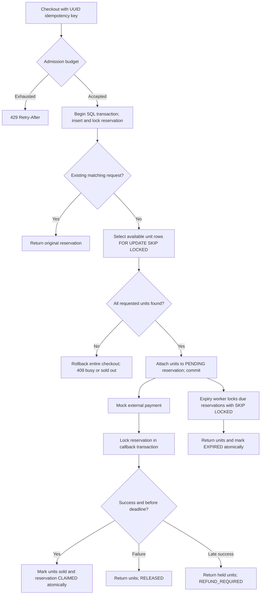
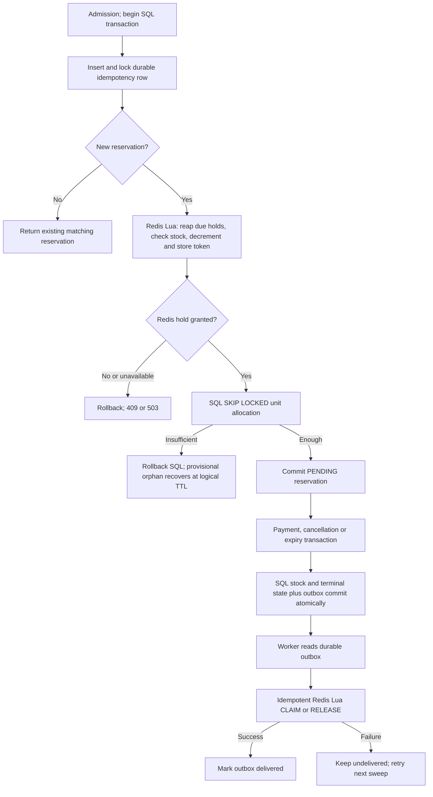
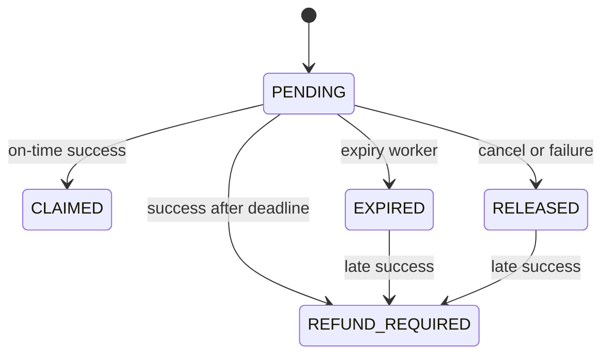

# FlashSales — Spring Boot reservation demo

Java 21 / Spring Boot 3.5, PostgreSQL 16, Redis 7.4. A runnable, local-scale comparison of **SQL-only** and **Redis + SQL** stock reservations with admission control, expiry, payment callbacks and concurrency tests.

## Context and scope

The original repository contained two flow diagrams. They are preserved below. The [referenced video](https://youtu.be/CheTuMvFXwc) discusses Shopify's migration from Redis to SQL. [Shopify's engineering article](https://shopify.engineering/scaling-inventory-reservations) describes per-unit reservations using `SKIP LOCKED` to avoid a single hot quantity row, and colocating reservations with the inventory ledger for atomic settlement.

This project adapts that idea to **PostgreSQL**, not Shopify's MySQL implementation. It models one sale/product/location with a finite pool of 100 stock units. It deliberately omits Shopify's replenishment pool, multi-location/cart batching and production-scale infrastructure. Both modes use the same SQL safety backstop. The Redis mode demonstrates provisional stock gating and the cost of coordinating two stores; it does not claim a distributed ACID transaction.

## Run locally

Prerequisites: Docker Engine/Desktop running with Linux containers and Docker Compose v2. For running outside Docker or tests: JDK 21 and Maven 3.6.3+. For the optional load script: Python 3.

```sh
docker compose up --build -d
docker compose logs -f app
curl http://localhost:8080/actuator/health
curl http://localhost:8080/api/inventory
```

Default mode is `SQL`. For the second scenario, use a fresh database and Redis data together. **The following reset deletes this demo's reservations, sales and stock data.**

```sh
docker compose down -v
SALE_MODE=REDIS_SQL docker compose up --build -d
```

PowerShell equivalent:

```powershell
docker compose down -v
$env:SALE_MODE = 'REDIS_SQL'
docker compose up --build -d
```

You can also put `SALE_MODE=REDIS_SQL` in a local `.env` file. That file is ignored by Git. Switching back requires clearing this setting and resetting both volumes. Startup refuses mode/stock changes for an existing database to prevent accidental inventory resets.

Run Java on the host while keeping dependencies in Docker:

```sh
docker compose up -d postgres redis
mvn spring-boot:run
```

SQL mode works without Redis (`docker compose up -d postgres`), although the all-in-one Compose stack starts both services for convenience. Redis failures do not affect SQL reservation logic. Redis health checking is disabled in Actuator so SQL mode does not depend on Redis; in Redis mode, `/actuator/health` alone does not prove the provisional gate is healthy. Check Redis and outbox backlog separately.

## Local defaults and configuration

| Environment variable | Default | Meaning |
|---|---|---|
| `SALE_MODE` | `SQL` | `SQL` or `REDIS_SQL`; immutable for an existing sale |
| `SALE_STOCK` | `100` | Initial units; 1–10,000; immutable after seeding |
| `SALE_MAX_QUANTITY` | `5` | Maximum units per checkout; 1–100 |
| `SALE_RESERVATION_TTL` | `30s` | Hold deadline, checked using database time |
| `SALE_ADMISSION_CONCURRENCY` | `8` | Maximum concurrent reservation requests per instance |
| `SALE_ADMISSION_PER_SECOND` | `50` | Fixed-window ingress limit per instance |
| `SALE_SWEEP_MS` | `1000` | Expiry/outbox worker delay on host; override Spring property in Compose if needed |
| `SALE_CALLBACK_SECRET` | `local-demo-secret` | Shared mock callback secret |
| `DB_URL`, `DB_USER`, `DB_PASSWORD` | Local PostgreSQL demo credentials | Database connection |
| `REDIS_HOST`, `REDIS_PORT` | `localhost`, `6379` | Redis connection |

SQL connection pool: 12; transaction timeout: 5 seconds; Redis timeout: 1 second. Admission applies to reserve requests, including retries; callback/release/expiry bypass it so settlement can progress under load. Limits are **per instance**, not cluster-wide. A fixed-window rate limiter can admit a burst across a window boundary. Deploy a shared edge limiter/waiting room for real distributed admission or fairness.

## SQL-only flow



Units use composite primary key `(sale_id, unit_id)` and an index over free units. `READ COMMITTED` transactions lock only selected units. A multi-unit request is all-or-nothing. `SKIP LOCKED` can return fewer units when available rows are busy: a 409 is retryable and does not necessarily mean permanent sellout. Reservations serialize their terminal transitions on a row lock. SQL deadlock/connection failures surface as retryable 503 responses.

## Redis + SQL flow



Lua holds use a hash of `reservation UUID → quantity`, a sorted set of deadlines, and an available counter in one Redis Cluster hash slot. Redis server time determines its logical deadlines. This is **logical TTL**, not automatic key expiry: expiring a key alone cannot safely replenish a counter. The next reserve reaps up to 200 due provisional holds. SQL's worker independently returns durable expired reservations; outbox settlement removes their Redis holds even without new traffic. An orphan created before SQL rollback expires on subsequent reserve traffic.

`RELEASE` returns a still-present hold exactly once; `CLAIM` removes a hold without incrementing availability. Replaying either after a lost delivery acknowledgment is a no-op. SQL commits the ledger and outbox together; workers retry undelivered entries. A process crash between Redis reserve and SQL commit can temporarily reduce admission until the orphan TTL. An ambiguous SQL commit must **not** trigger unconditional Redis compensation, because SQL might have committed. PostgreSQL remains the final authority in all cases.

Redis deadlines can elapse before SQL cleanup, and Redis data loss can reinitialize its counter too high. SQL still rejects overselling; Redis is then an approximate gate. It can also under-admit until expiry. Redis must not be interpreted as the authoritative stock ledger. This safety choice means the hybrid still allocates SQL unit rows and is not a benchmark of a pure Redis reservation design.

## API and idempotency

| Method/path | Input | Result |
|---|---|---|
| `POST /api/reservations` | UUID `Idempotency-Key`; customer, quantity | Matching retry returns the original reservation; changed payload gives 409 |
| `GET /api/reservations/{id}` | Reservation UUID | Current persisted state; 404 if missing |
| `DELETE /api/reservations/{id}` | Reservation UUID | Idempotent cancellation; never releases sold stock |
| `POST /api/mock-payments/{id}` | `X-Callback-Secret`; UUID paymentId, SUCCESS/FAILURE | Mock gateway callback, idempotent by recorded payment identity/outcome |
| `GET /api/inventory` | None | SQL total, available, reserved, sold |

Responses use HTTP 200 for successful operations; 400 validation; 401 callback secret; 404 missing reservation; 409 stock busy/unavailable or idempotency/payment conflict; 429 admission; 503 storage failure. 429/503 include `Retry-After: 1`. Reuse the same reservation key after transport failure. A UUID key represents one logical checkout; it cannot be recycled after cancellation/expiry. UUIDs identify requests, not authorization.

Bash/curl walkthrough (replace IDs for another checkout):

```sh
ID=11111111-1111-4111-8111-111111111111
PAYMENT=22222222-2222-4222-8222-222222222222
curl -X POST http://localhost:8080/api/reservations \
  -H 'Content-Type: application/json' -H "Idempotency-Key: $ID" \
  -d '{"customer":"alice","quantity":2}'
curl http://localhost:8080/api/reservations/$ID
curl -X POST http://localhost:8080/api/mock-payments/$ID \
  -H 'Content-Type: application/json' -H 'X-Callback-Secret: local-demo-secret' \
  -d "{\"paymentId\":\"$PAYMENT\",\"outcome\":\"SUCCESS\"}"
curl http://localhost:8080/api/inventory
curl -X DELETE http://localhost:8080/api/reservations/$ID
```

PowerShell walkthrough:

```powershell
$id = [guid]::NewGuid().ToString()
$payment = [guid]::NewGuid().ToString()
Invoke-RestMethod -Method Post -Uri http://localhost:8080/api/reservations `
  -Headers @{'Idempotency-Key'=$id} -ContentType application/json `
  -Body (@{customer='alice'; quantity=2} | ConvertTo-Json)
Invoke-RestMethod -Method Post -Uri "http://localhost:8080/api/mock-payments/$id" `
  -Headers @{'X-Callback-Secret'='local-demo-secret'} -ContentType application/json `
  -Body (@{paymentId=$payment; outcome='SUCCESS'} | ConvertTo-Json)
Invoke-RestMethod http://localhost:8080/api/inventory
```

For failure, use a new reservation and `outcome: FAILURE`. For cancellation, DELETE a pending reservation twice. For late payment, reserve with a new ID, wait longer than the 30-second TTL, then send SUCCESS. The result is `REFUND_REQUIRED`, regardless of whether the expiry worker already ran. Repeat the same callback to see idempotency. No real money is charged or refunded: **the mock gateway is the callback endpoint**, and `REFUND_REQUIRED` records required compensation. A real gateway needs signed callbacks, a durable payment/refund outbox, retries and reconciliation.

## State and concurrency rules



Database time after acquiring the reservation lock is the settlement decision point. A request sent before TTL but processed after it needs compensation. A successful claim makes sold units permanent. Releasing a claimed reservation is a no-op. If cancellation wins the lock race, a subsequent successful payment requires a refund; if payment wins, cancellation cannot return sold stock. Conflicting outcomes for the same payment return 409; a globally unique payment ID cannot pay for two reservations. This mock accepts one definitive outcome per checkout; handling a gateway reversal after a recorded failure is outside its contract.

The invariant is `total = available + reserved + sold`; only `PENDING` reservations own unsold held units, and only `CLAIMED` reservations own sold units. Expired-but-unswept reservations still count as reserved in inventory; they cannot be claimed after their deadline.

## Tests

```sh
mvn -B verify
```

JUnit/Testcontainers creates isolated PostgreSQL and Redis containers, applies Flyway migrations, and starts Spring Boot. Docker must be available; integration tests deliberately **fail** if it is not, rather than silently skipping correctness checks. GitHub Actions runs this command on Ubuntu with Java 21 and uploads test reports.

```sh
# No Docker required: admission unit test and compile all test sources
mvn -B -Dtest=AdmissionControlTest test
# SQL suite only (includes its infrastructure fixtures)
mvn -B -Dtest=ReservationIntegrationTest test
# Redis + SQL suite, including inherited concurrency/settlement tests
mvn -B -Dtest=RedisSqlIntegrationTest test
```

Coverage includes 40 buyers racing for 20 units, duplicate keys, all-or-nothing quantities, claim/cancel and claim/expiry races, failure and callback replay, late payment before/after sweeping, reused payment IDs, invalid API input/secret, atomic Lua replay, orphan expiry, Redis loss, fail-closed Redis outage and durable outbox retry after simulated delivery failure. Tests move deadlines into the past instead of depending on sleeps. The Redis fixture simulates delivery errors with a spy; it does not reproduce every network partition or process crash.

Optional live exercise (the default limits intentionally produce some 429s):

```sh
python scripts/load_test.py --requests 100 --workers 16
```

This prints HTTP outcome counts and checks SQL's inventory sum; it creates unpaid holds that the worker later expires. Run integration tests for deeper invariants. Repeat after the TTL to observe returned stock. Load results are local demonstrations, not throughput guarantees.

## Tradeoffs and operational limits

| Aspect | SQL | Redis + SQL |
|---|---|---|
| Reserve | SQL unit locks and transaction | Redis Lua plus SQL unit allocation |
| Claim/release safety | Ledger and reservation in one transaction | Same SQL safety, plus asynchronous Redis cleanup |
| Stock contention | Skip locked units; busy attempts may retry | Preliminary gate, same SQL backstop |
| Failure recovery | Durable database state and expiry worker | Also logical orphan TTL and durable settlement outbox |
| Operating cost | One authoritative datastore | Two stores; approximate gate can temporarily under/over-admit |

This is a local backend demo, not a production storefront: no customer authentication, ownership checks, real payment/refund execution, waiting-room fairness, multiple products/locations, stock replenishment or retention/archiving of terminal reservations/outbox. Ports bind to localhost; use proper secrets, authentication and gateway signatures before exposing it. The single 100-unit pool favors clarity; a very large catalog needs a bounded/replenished pool and careful lifecycle design. A worker processes up to 100 entries per sweep; tune and monitor backlogs. Redis delivery occurs while the outbox rows are locked; keep its timeout short and isolate worker capacity for larger deployments. Request idempotency lasts as long as reservation rows are retained.

Useful diagnostics:

```sh
docker compose exec postgres psql -U flashsale -d flashsale -c "SELECT state,count(*) FROM reservation GROUP BY state;"
docker compose exec postgres psql -U flashsale -d flashsale -c "SELECT count(*) FROM redis_outbox WHERE NOT delivered;"
docker compose exec redis redis-cli GET 'flash:{sale1}:available'
docker compose logs app
```

## Original reference diagrams

Redis based:


SQL based:


